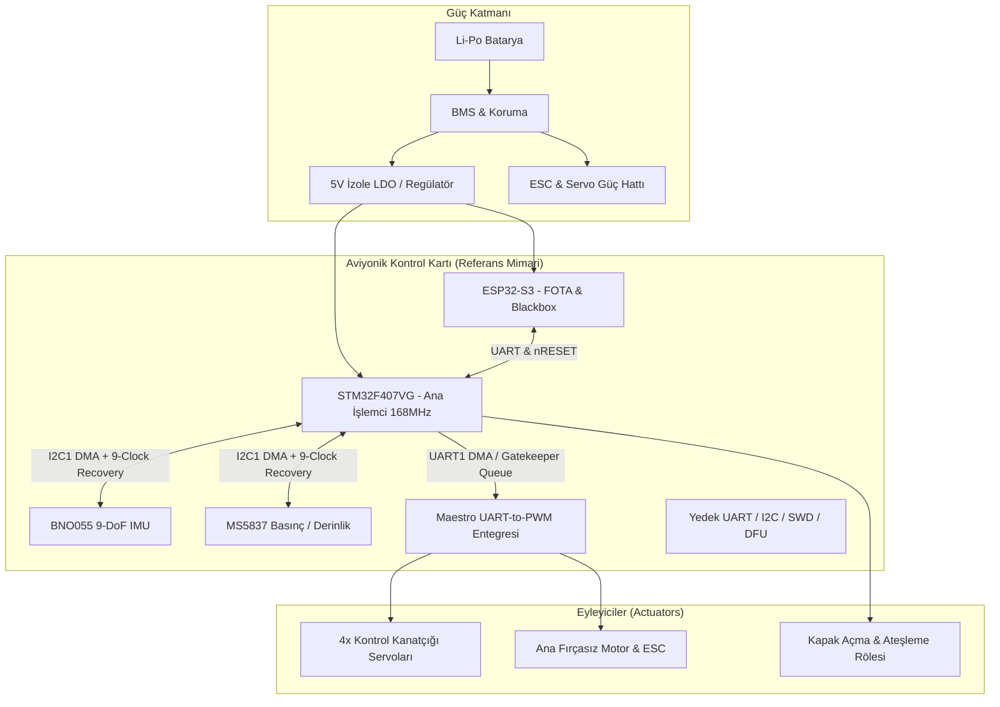
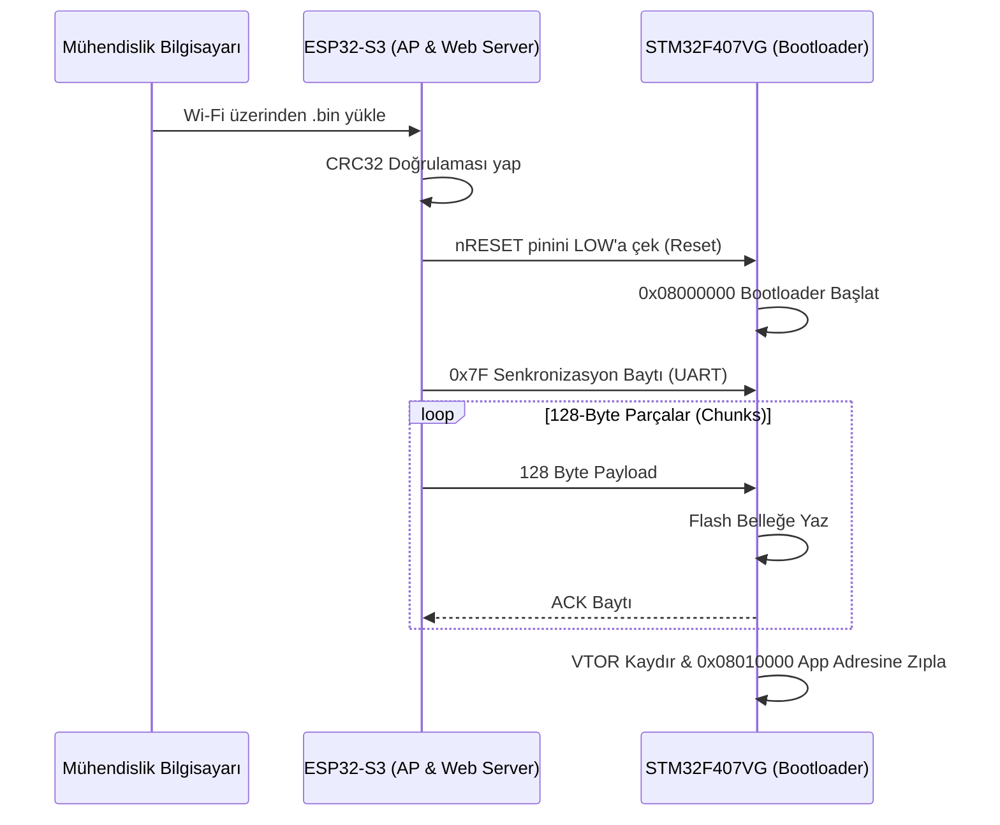

<div align="center">
  
  <br>
  
  
  # 🌊 TEKNOFEST SU ALTI ROKETİ
  ### *Açık Kaynak Geliştirici Rehberi ve Referans Aviyonik Mimarisi*
  ### *Advanced Autonomous Underwater Rocket Framework for All Teams*
  
  [](https://opensource.org/licenses/MIT)
  [](electronics/pinout.md)
  [](docs/ENGINEERING_ANATOMY.md)
  [](docs/ENGINEERING_ANATOMY.md#5-kablosuz-güncelleme-mimarisi-esp32-s3-ile-fota-ve-kara-kutu-blackbox)
  [](docs/ENGINEERING_ANATOMY.md#c-template-tabanlı-kalman-filtresi-eskf)
  [](#-bu-deponun-amacı-ve-açık-kaynak-vizyonu)

  ---
  
  **TEKNOFEST ve Roketsan Su Altı Roketi Yarışması**'na katılan tüm üniversite ve lise takımlarına, araştırmacılara ve mühendis adaylarına rehberlik etmek üzere kurulmuş **bağımsız ve açık kaynaklı bir referans geliştirme platformudur.**
</div>

---

## 💡 Bu Deponun Amacı ve Açık Kaynak Vizyonu

Su altı roketi konsepti, geleneksel ROV sistemlerinden ve hava roketlerinden köklü biçimde ayrılan, hidrodinamik kısıtları son derece yüksek bir mühendislik alanıdır. Dünyada ve ülkemizde bu özel konsepte yönelik açık kaynaklı mimari, referans gömülü kod ve saha tecrübesi eksikliğini gidermek amacıyla bu depo oluşturulmuştur.

> 🏆 **Vaka Analizi & Referans Mimari:**  
> Depo içeriğindeki donanım şemaları, FreeRTOS görev kurguları, FOTA kablosuz yükleme mekanizması ve seyrüsefer (ESKF) algoritmaları; Roketsan Su Altı Roketi Yarışması'nda **Türkiye Birinciliği (Şampiyonluk)** elde eden İTÜ Sungur Takımı'nın ve sahada başarı göstermiş ekiplerin kanıtlanmış mühendislik çözümleri referans alınarak genelleştirilmiş ve tüm takımların istifadesine sunulmuştur.

---

## 📖 Kapsamlı Mühendislik Rehberi ve Vaka Analizi

> 🔗 Donanım tasarımından FreeRTOS DMA yapılandırmasına, I2C Bus Lock kriz yönetiminden FOTA mimarisine kadar tüm teknik ayrıntılar için ana raporu inceleyin:  
> **👉 [Şampiyon Roketin Mühendislik Anatomisi: STM32, FreeRTOS ve FOTA ile Su Altı Otonomisi](docs/ENGINEERING_ANATOMY.md)**

---

## 🚀 Öne Çıkan Referans Mimari Özellikleri

- **STM32F407VG Ana Uçuş Kontrolcüsü (FC):** 168 MHz ARM Cortex-M4F, donanımsal FPU ve CMSIS-DSP statik kütüphaneleriyle optimize edilmiş deterministik uçuş kontrol çekirdeği.
- **ESP32-S3 ile FOTA & Blackbox:** Gövde sızdırmazlığını bozmadan Wi-Fi üzerinden 128-byte chunk'larla kablosuz STM32 yazılım güncellemesi ve 8MB PSRAM üzerinde yüksek frekanslı kara kutu telemetri kaydı.
- **FreeRTOS & DMA Gatekeeper Mimarisi:** HAL kütüphanesinin bloklayan çağrılarını devre dışı bırakan, UART erişimlerini atomik ve thread-safe hale getiren Gatekeeper Task & Queue yapısı.
- **Zero-Allocation C++ Template ESKF:** Heap tahsisini sıfırlayan, heap fragmentation riskini yok eden Error State Kalman Filter (CMSIS-DSP destekli).
- **I2C Bus Lock Recovery (Saha Dayanıklılığı):** Tuzlu su ve elektriksel gürültü kaynaklı I2C kilitlenmelerinde SCL hattına 9 clock vurarak köle sensörün SDA hattını serbest bırakan donanımsal kurtarma mekanizması.
- **OS-Agnostic Sürücü Katmanı:** Hem FreeRTOS altında hem de bootloader/startup aşamasında tek kod tabanıyla çalışan function pointer delay callback mimarisi.
- **Yunuslama ve Roket Ateşleme Döngüsü:** 4 adet aerodinamik kontrol kanatçığıyla pitch-up (yunuslama) manevrası, su yüzeyine çıkış, mekanik kapak açılışı ve model roket otonom ateşleme sekansı.

---

## 🎯 Yarışma Konsepti ve Görev Profilleri (Roketsan Şartnamesi)

Roketsan Su Altı Roketi Yarışması; standart ROV sistemlerinden farklı olarak kapsül atım ve torpido dinamiğine dayanır. Yan iticiler veya hovering yasaktır; yönelim 4 kontrol kanatçığıyla (+ veya X konfigürasyonu), itki ise tek bir fırçasız motorla sağlanır.

```mermaid
flowchart TD
    subgraph "Görev 1: Otonom Seyir & Geri Dönüş (300 Puan)"
        G1_A[Başlangıç Çizgisi] -->|50m Su Altı Otonom Seyir| G1_B[Hedef Nokta]
        G1_B -->|180° Keskin Dönüş Manevrası| G1_C[Geri Dönüş Seyri]
        G1_C -->|50m Geri Seyir| G1_D[Başlangıç Noktasına Varış & Motor Stop]
    end

    subgraph "Görev 2: Yunuslama & Roket Ateşleme (400 Puan)"
        G2_A[Otonom Seyir] -->|Hedef Güvenli Bölge| G2_B["Yunuslama Manevrası (Pitching)"]
        G2_B -->|Sathına Çıkış| G2_C[Yüzeye Ulaşma]
        G2_C -->|Mekanik Kapak Açılışı| G2_D[Faydalı Yük Hazırlığı]
        G2_D -->|Otonom Ateşleme| G2_E[Model Roket Fırlatılışı 🚀]
    end
```



---

## 🔌 Referans Donanım ve Aviyonik Topolojisi

Tüm takımlar için önerilen tek parça veya modüler Uçuş Kontrol Kartı (FC) topolojisi; sahada karşılaşılabilecek tüm kriz senaryolarına karşı yedekli donanımsal hatlar ve izole güç katmanı ile kurgulanmalıdır.



Detaylı pin konfigürasyonu ve donanım hatları için [electronics/pinout.md](electronics/pinout.md) dosyasına göz atın.

---

## 📡 FOTA (Firmware Over-The-Air) & Kara Kutu Akışı

Saha testlerinde gövde sızdırmazlık vidalarını açmadan saniyeler içinde yeni yazılım yüklenmesini sağlayan mimari:



---

## ⚙️ Modern Geliştirme Ortamı (VS Code + CMake + Ninja)

STM32CubeIDE'nin hantallığını aşmak için takımlara tavsiye edilen modern gömülü araç zinciri:

* **Derleyici:** ARM GNU Toolchain (`arm-none-eabi-gcc` / `g++`)
* **Derleme Sistemi:** CMake + Ninja (3 kat daha hızlı artımlı derleme)
* **Intellisense:** Clangd (`compile_commands.json` ile `#ifdef` dostu sembol çözümleme)
* **Canlı Hata Ayıklama:** Cortex-Debug + SVD (System View Description) üzerinden anlık register takibi
* **Profilleme:** Segger SystemView & RTT ile FreeRTOS context-switching ve ISR jitter analizi

```bash
# Firmware yapılandırma (PCB donanım hedefi ile)
cd firmware
cmake -B build -G Ninja -DTARGET_HARDWARE=PCB

# Derleme
ninja -C build
```

---

## 📂 Proje Dizin Yapısı

```text
teknofest_su_alti_roket/
├── docs/
│   ├── ENGINEERING_ANATOMY.md   # Şampiyon Roketin Mühendislik Anatomisi (Detaylı Rapor)
│   ├── specs/                   # Yarışma şartnameleri (Roketsan V1.2)
│   └── reports/                 # OTR, KTR ve Final tasarım rapor şablonları
├── firmware/                    # STM32F407VG + FreeRTOS + FOTA Üretim Kodları
│   ├── include/                 # Header dosyaları (ESKF, PID, Watchdog, Sürücüler)
│   ├── src/                     # C/C++ kaynak kodları (Gatekeeper, Görev Yöneticisi)
│   ├── esp32_s3_firmware/       # ESP32-S3 FOTA Wi-Fi Server & PSRAM Blackbox
│   └── CMakeLists.txt           # Modüler derleme mimarisi
├── electronics/
│   ├── pinout.md                # STM32F407 & ESP32-S3 referans pin haritası
│   ├── schematics/              # Devre şemaları
│   └── pcb/                     # Kart yerleşim ve üretim dosyaları
├── sim/
│   └── mission_simulator.py     # Görev 1 & Görev 2 hidrodinamik simülatörü
├── src/
│   ├── navigation/              # Python prototip algoritmaları
│   └── gcs/                     # Yer Kontrol İstasyonu ve Blackbox log parser
├── analysis/                    # CFD, itki ve yapısal analiz klasörleri
├── design/                      # CAD modelleri ve teknik çizimler
└── tests/                       # ESKF, Blackbox ve FSM birim testleri (100% Pass)
```

---

## 🏆 Mühendislik Karnesi (Tüm Takımlar İçin Do's & Don'ts)

| Yapılması Gerekenler (Do's) | Kaçınılması Gerekenler (Don'ts) |
| :--- | :--- |
| **Sensör Birleştirme:** Tüm sensörleri tek bir IO task'ı altında toplayıp Getter/Setter ile dağıtmak. | **Over-Tasking:** Her sensör için ayrı Task açıp işlemciyi Context Switch yüküne boğmak. |
| **Thread-Safe Haberleşme:** Görevler arası veri aktarımında Queue ve Semaphore kullanmak. | **Kritik Bölge Suistimali:** Değişken paylaşımlarında `portENTER_CRITICAL()` ile kesmeleri kapatmak. |
| **Bütünleşik Watchdog:** Task sağlıklarını 100 ms yenileme pencereli Software Watchdog ile izlemek. | **Teşhis Eksikliği:** HardFault handler'ları boş bırakmak ve register dökümünü ihmal etmek. |
| **Modern C++:** Tüm katmanları baştan C++ OOP, RAII ve Template yapılarıyla kurgulamak. | **Sabit dt Varsayımı:** `vTaskDelay` sürelerinin mükemmel sabitliğine güvenmek (Donanımsal Timer ile dt ölçülmeli). |

---

## 💻 Simülasyon ve Testleri Çalıştırma

```bash
# Birim testleri çalıştırma
python -m unittest discover tests

# Hidrodinamik görev simülasyonunu koşturma
python sim/mission_simulator.py
```

---

## 🤝 Katkıda Bulunma
Bu repo tüm TEKNOFEST ekiplerinin ortak faydalanması ve katkı sunması için kurulmuştur. Yeni sensör sürücüleri, simülasyon modelleri veya mimari iyileştirmeler için PR (Pull Request) gönderebilirsiniz.

## 📜 Lisans
Bu proje **MIT Lisansı** altında lisanslanmıştır. Detaylar için [LICENSE](LICENSE) dosyasına göz atın.

---
<div align="center">
  <b>Designed for Reliability, Engineered for the Deep.</b><br>
  Tüm <b>TEKNOFEST Su Altı Roketi</b> Takımlarına Başarılar Dileriz! 🚀🌊
</div>
