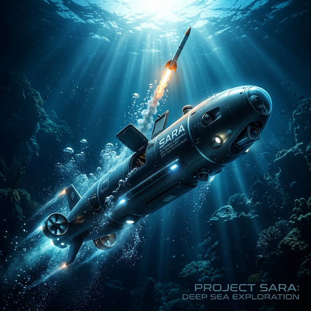
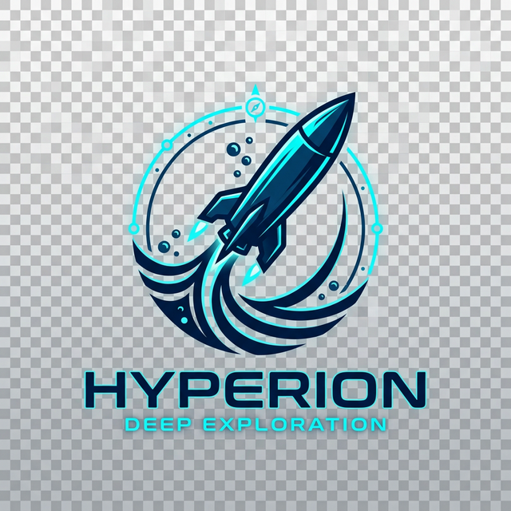
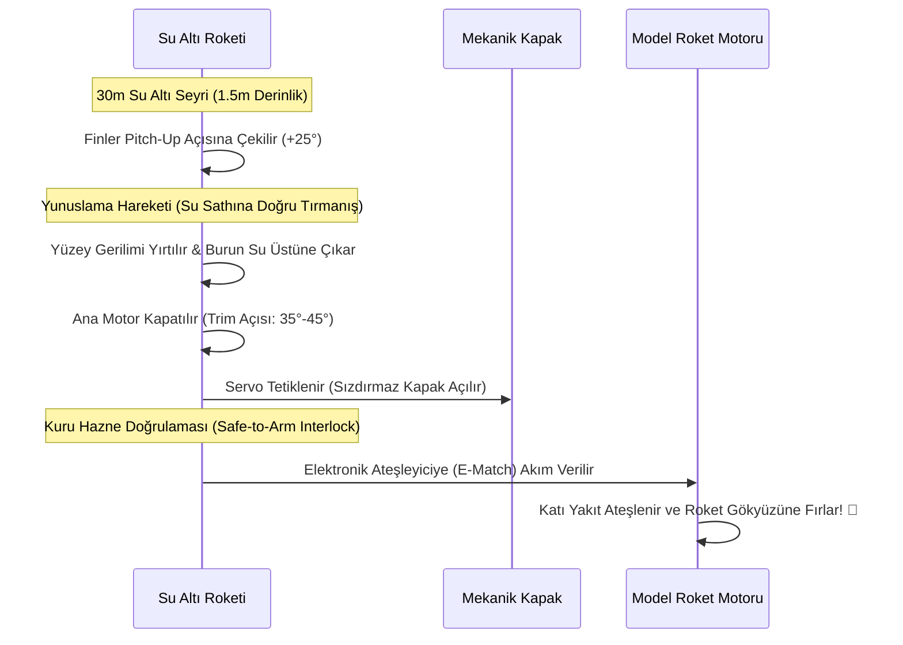
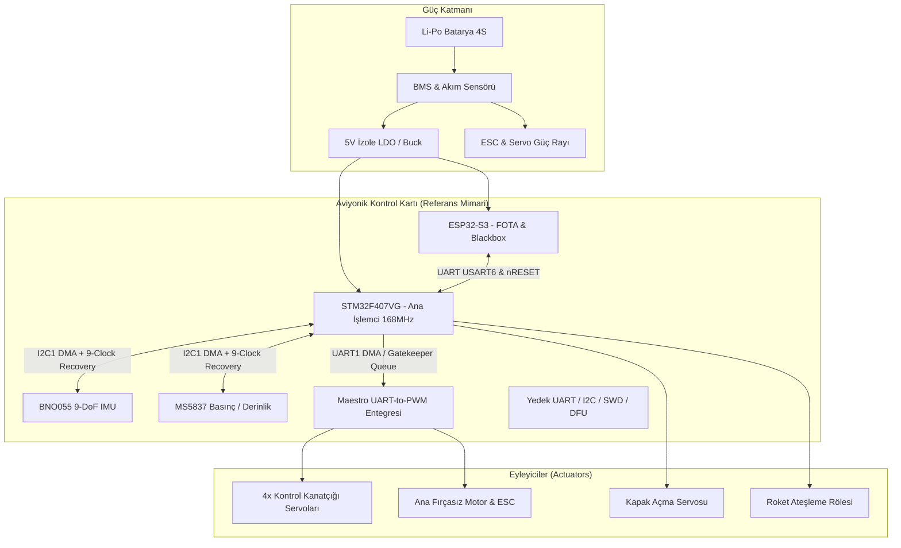
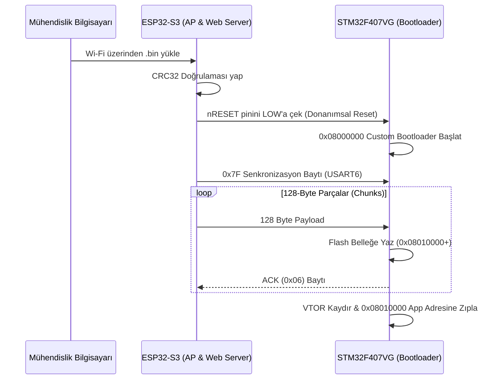

<div align="center">
  
  <br>
  
  
  # 🌊 TEKNOFEST SU ALTI ROKETİ
  ### *Açık Kaynak Geliştirici Rehberi, Rakip Analizi ve Referans Aviyonik Mimarisi*
  ### *Advanced Autonomous Underwater Rocket Framework for All Teams*
  
  [](https://opensource.org/licenses/MIT)
  [](https://github.com/bahattinyunus/teknofest_su_alti_roket/actions/workflows/ci.yml)
  [](electronics/pinout.md)
  [](docs/ENGINEERING_ANATOMY.md)
  [](docs/ENGINEERING_ANATOMY.md#5-kablosuz-güncelleme-mimarisi-esp32-s3-ile-fota-ve-kara-kutu-blackbox)
  [](docs/ENGINEERING_ANATOMY.md#c-template-tabanlı-kalman-filtresi-eskf)
  [](#-bu-deponun-amacı-ve-açık-kaynak-vizyonu)

  ---
  
  **TEKNOFEST ve Roketsan Su Altı Roketi Yarışması**'na katılan tüm üniversite ve lise takımlarına, araştırmacılara ve mühendis adaylarına rehberlik etmek üzere kurulmuş **bağımsız ve açık kaynaklı bir referans geliştirme platformudur.**
</div>

---

## 📌 İçindekiler
1. [Bu Deponun Amacı ve Açık Kaynak Vizyonu](#-bu-deponun-amacı-ve-açık-kaynak-vizyonu)
2. [Kapsamlı Mühendislik Rehberi ve Vaka Analizi](#-kapsamlı-mühendislik-rehberi-ve-vaka-analizi)
3. [Öne Çıkan Referans Mimari Özellikleri](#-öne-çıkan-referans-mimari-özellikleri)
4. [Yarışma Konsepti ve Görev Profilleri (Roketsan Şartnamesi)](#-yarışma-konsepti-ve-görev-profilleri-roketsan-şartnamesi)
5. [🌍 Küresel Yarışmalar ve Karşılaştırmalı Ekosistem Analizi](#-küresel-yarışmalar-ve-karşılaştırmalı-ekosistem-analizi)
6. [🔍 Karşılaştırmalı Rakip ve Sistem Mimarisi Matrisi](#-karşılaştırmalı-rakip-ve-sistem-mimarisi-matrisi)
7. [💻 Açık Kaynak Global Referans Projeler ve Kod Depoları](#-açık-kaynak-global-referans-projeler-ve-kod-depoları)
8. [📐 Torpido Hidrodinamiği ve Kontrol Kanatçığı Analizi: Haç (+) vs X-Rudder (X)](#-torpido-hidrodinamiği-ve-kontrol-kanatçığı-analizi-haç--vs-x-rudder-x)
9. [🚀 Su-Hava Faz Geçişi ve Balistik Roket Ateşleme Fiziği](#-su-hava-faz-geçişi-ve-balistik-roket-ateşleme-fiziği)
10. [🔌 Referans Donanım ve Aviyonik Topolojisi](#-referans-donanım-ve-aviyonik-topolojisi)
11. [📡 FOTA (Firmware Over-The-Air) & Kara Kutu Akışı](#-fota-firmware-over-the-air--kara-kutu-akışı)
12. [⚙️ Modern Geliştirme Ortamı (VS Code + CMake + Ninja)](#️-modern-geliştirme-ortamı-vs-code--cmake--ninja)
13. [📂 Proje Dizin Yapısı](#-proje-dizin-yapısı)
14. [🏆 Mühendislik Karnesi (Tüm Takımlar İçin Do's & Don'ts)](#-mühendislik-karnesi-tüm-takımlar-için-dos--donts)
15. [💻 Simülasyon ve Testleri Çalıştırma](#-simülasyon-ve-testleri-çalıştırma)
16. [🤝 Katkıda Bulunma ve Lisans](#-katkıda-bulunma-ve-lisans)

---

## 💡 Bu Deponun Amacı ve Açık Kaynak Vizyonu

Su altı roketi konsepti; geleneksel ROV (Remotely Operated Vehicle) sistemlerinden, havuz tabanlı AUV'lerden ve klasik atmosferik model roketlerden köklü biçimde ayrılan, çok disiplinli ve hidrodinamik kısıtları son derece sert bir mühendislik sahasıdır. Dünyada ve Türkiye'de bu özgün konsepte yönelik açık kaynaklı mimari doküman, referans gömülü yazılım şablonu ve saha tecrübesi eksikliğini gidermek amacıyla bu bağımsız depo hayata geçirilmiştir.

> 🏆 **Vaka Analizi & Doğrulanmış Mimari:**  
> Depo içeriğindeki donanım topolojileri, FreeRTOS görev kurguları, FOTA kablosuz güncelleme protokolü ve C++ Template ESKF seyrüsefer algoritmaları; Roketsan Su Altı Roketi Yarışması'nda **Türkiye Birinciliği (Şampiyonluk)** elde eden İTÜ Sungur Takımı'nın ve sahada başarı gösteren diğer öncü ekiplerin gerçek saha tecrübeleri baz alınarak genelleştirilmiş ve tüm yarışmacı takımların kullanımına sunulmuştur.

---

## 📖 Kapsamlı Mühendislik Rehberi ve Vaka Analizi

> 🔗 Donanım tasarımından FreeRTOS DMA yapılandırmasına, I2C Bus Lock kriz yönetiminden FOTA mimarisine kadar tüm teknik ayrıntılar için ana raporu inceleyin:  
> **👉 [Şampiyon Roketin Mühendislik Anatomisi: STM32, FreeRTOS ve FOTA ile Su Altı Otonomisi](docs/ENGINEERING_ANATOMY.md)**

---

## 🚀 Öne Çıkan Referans Mimari Özellikleri

- **STM32F407VG Ana Uçuş Kontrolcüsü (FC):** 168 MHz ARM Cortex-M4F, donanımsal FPU ve CMSIS-DSP statik kütüphaneleriyle optimize edilmiş deterministik uçuş kontrol çekirdeği.
- **ESP32-S3 ile FOTA & Blackbox:** Gövde sızdırmazlığını bozmadan Wi-Fi üzerinden 128-byte chunk'larla kablosuz STM32 yazılım güncellemesi ve 8MB PSRAM üzerinde yüksek frekanslı kara kutu telemetri kaydı.
- **FreeRTOS & DMA Gatekeeper Mimarisi:** HAL kütüphanesinin bloklayan çağrılarını devre dışı bırakan, UART erişimlerini atomik ve thread-safe hale getiren Gatekeeper Task & Queue yapısı.
- **Zero-Allocation C++ Template ESKF:** Heap tahsisini sıfırlayan, heap fragmentation riskini yok eden Error State Kalman Filter (CMSIS-DSP destekli).
- **I2C Bus Lock Recovery (Saha Dayanıklılığı):** Tuzlu su ve elektriksel gürültü kaynaklı I2C kilitlenmelerinde SCL hattına 9 clock vurarak köle sensörün SDA hattını serbest bırakan donanımsal kurtarma mekanizması.
- **OS-Agnostic Sürücü Katmanı:** Hem FreeRTOS altında hem de bootloader/startup aşamasında tek kod tabanıyla çalışan function pointer delay callback mimarisi.
- **Yunuslama ve Roket Ateşleme Döngüsü:** 4 adet aerodinamik kontrol kanatçığıyla pitch-up (yunuslama) manevrası, su yüzeyine çıkış, mekanik kapak açılışı ve model roket otonom ateşleme sekansı.

---

## 🎯 Yarışma Konsepti ve Görev Profilleri (Roketsan Şartnamesi)

Roketsan Su Altı Roketi Yarışması; standart ROV sistemlerinden farklı olarak kapsül atım ve torpido dinamiğine dayanır. Yan iticiler veya hovering yasaktır; yönelim 4 kontrol kanatçığıyla (+ veya X konfigürasyonu), itki ise tek bir fırçasız motorla sağlanır.

```mermaid
flowchart TD
    subgraph "Görev 1: Otonom Seyir & Geri Dönüş (300 Puan)"
        G1_A[Başlangıç Çizgisi] -->|50m Su Altı Otonom Seyir| G1_B[Hedef Nokta]
        G1_B -->|180° Keskin Dönüş Manevrası| G1_C[Geri Dönüş Seyri]
        G1_C -->|50m Geri Seyir| G1_D[Başlangıç Noktasına Varış & Motor Stop]
    end

    subgraph "Görev 2: Yunuslama & Roket Ateşleme (400 Puan)"
        G2_A[Otonom Seyir] -->|Hedef Güvenli Bölge| G2_B["Yunuslama Manevrası (Pitching)"]
        G2_B -->|Sathına Çıkış| G2_C[Yüzeye Ulaşma]
        G2_C -->|Mekanik Kapak Açılışı| G2_D[Faydalı Yük Hazırlığı]
        G2_D -->|Otonom Ateşleme| G2_E[Model Roket Fırlatılışı 🚀]
    end
```



---

## 🌍 Küresel Yarışmalar ve Karşılaştırmalı Ekosistem Analizi

Su altı otonomisi alanında dünya genelinde düzenlenen önde gelen yarışmalar ile TEKNOFEST / Roketsan Su Altı Roketi Yarışması arasındaki temel konsept, dinamik ve mühendislik farkları aşağıda özetlenmiştir:

### 1. TEKNOFEST & Roketsan Su Altı Roketi (Türkiye)
- **Tasarım Felsefesi:** Torpido formu zorunluluğu, tek eksenli BLDC ana itki motoru ve 4 adet aerodinamik kontrol yüzeyi (kanatçık).
- **Benzersiz Zorluk:** Yan itici kullanımı ve suda asılı kalma (*hovering*) kesinlikle yasaktır. Araç, uçak aerodinamiğine benzer şekilde yalnızca ileri hız ($v_x > 0$) varken kontrol momenti üretebilir.
- **Görev Özgünlüğü:** Su altından su sathına yüksek açıyla yunuslama (*pitch-up*), yüzey gerilimini yırtarak çıkış, mekanik kapak açma ve su üzerinde kuru model roketi otonom ateşleme. Bu konsept, savunma sanayisindeki **denizaltı kapsül fırlatma sistemlerini (SLCM / Kapsüllü Seyir Füzesi)** simüle eder.

### 2. RoboSub (RoboNation / ONR — San Diego TRANSDEC, ABD)
- **Tasarım Felsefesi:** Genellikle 6 ila 8 serbestlik dereceli, vektörel iticilere sahip açık çerçeveli (open-frame) kutu tipi AUV'ler.
- **Görevler:** Akustik pinger takibi, kapılardan geçiş, görüntü işleme ile şamandıra tanıma, manipülatörle ağırlık bırakma ve basınçlı hava ile küçük torpido/marker atımı.
- **Kıyaslama:** Düşük seyir hızı ($0.5 - 1.0\text{ m/s}$), yüksek manevra kabiliyeti (yerinde sıfır yarıçaplı dönebilme ve derinlikte sabit asılı kalabilme), yüksek sürtünme katsayısı ($C_d \approx 0.8 - 1.2$). Torpido hidrodinamiği aranmaz.

### 3. SAUVC (Singapore AUV Challenge — Singapur / IEEE OES)
- **Tasarım Felsefesi:** Havuz ortamı için optimize edilmiş, kompakt, 4-6 iticili otonom su altı robotları.
- **Görevler:** Sarı kapıdan otonom geçiş, su altı akustik pinger lokasyonu, golf topunu hedef kovaya bırakma.
- **Kıyaslama:** Görüntü işleme (OpenCV/YOLO) ve akustik seyrüsefer odaklıdır. Dinamik yüzey çıkışı ve roket ateşleme gibi balistik faz geçişleri bulunmaz.

### 4. European Robotics League (ERL) Emergency / RAMI (La Spezia, İtalya — NATO CMRE)
- **Tasarım Felsefesi:** Açık deniz ve liman altyapılarında arama-kurtarma ve endüstriyel denetim yürüten büyük ölçekli AUV ve hibrit ROV'lar.
- **Görevler:** Boru hattı izleme, akustik haritalama, enkaz tespiti ve çoklu robot işbirliği.
- **Kıyaslama:** Ağır sensör yükü (DVL, multibeam sonar, USBL). Hızlı manevra ve torpido kontrolünden ziyade uzun menzilli dayanıklılık ön plandadır.

---

## 🔍 Karşılaştırmalı Rakip ve Sistem Mimarisi Matrisi

| Kriter | TEKNOFEST Su Altı Roketi | Klasik RoboSub AUV | SAUVC Robotları | Standart Endüstriyel ROV |
| :--- | :--- | :--- | :--- | :--- |
| **Gövde Formu** | **Torpido (Eksenel Simetrik)** | Açık İskelet (Kutu/Box-frame) | Kompakt Kutu / Katamaran | Ağır Çerçeve & Şamandıra Bloğu |
| **İtki Sistemi** | **1x BLDC Motor (Tek Yön)** | 6 - 8x Fırçasız İtici (Vektörel) | 4 - 6x İtici | 4 - 8x Güçlü İtici (Kablolu) |
| **Yönelim Kontrolü** | **4x Kanatçık (+ veya X Fin)** | İtici Diferansiyel Hızları | İtici Diferansiyel Hızları | İtici Diferansiyel Hızları |
| **Sürtünme Katsayısı ($C_d$)** | **$0.15 - 0.22$ (Çok Düşük)** | $0.80 - 1.30$ (Çok Yüksek) | $0.60 - 0.90$ (Yüksek) | $1.00 - 1.50$ (Aşırı Yüksek) |
| **Hovering (Askıda Kalma)** | **YASAK (Sıfır Hızda Kontrol Yok)** | Var (6-DoF Tam Kontrol) | Var (Derinlik Sabitleme) | Var (Kablolu Sürekli Güç) |
| **Seyir Hızı** | **$2.0 - 3.5\text{ m/s}$ (Yüksek Hız)** | $0.5 - 1.2\text{ m/s}$ | $0.4 - 0.8\text{ m/s}$ | $0.5 - 1.5\text{ m/s}$ |
| **Yunuslama (Pitching) Manevrası** | **Zorunlu ($30^\circ - 50^\circ$ Dinamik)** | Opsiyonel / Düz Eğim | Nadir | Yok (Daima Yatay) |
| **Faz Geçişi (Su $\rightarrow$ Hava)** | **Var (Yüzey Gerilimi Yırtma)** | Yok | Yok | Yok |
| **Faydalı Yük** | **Kuru Hazneli Model Roket** | Pnömatik Torpido / Marker | Plastik Top Bırakma | Hidrolik/Elektrik Manipülatör |
| **Uçuş Kontrolcüsü (FC)** | **STM32F407 (Hard Real-Time RTOS)** | Jetson / NUC + Pixhawk/Teensy | Raspberry Pi + Arduino | Topside PC + PLC / STM32 |
| **Zamanlama Determinizmi** | **Mikrosaniye Seviyesi (FreeRTOS)** | Milisaniye (ROS/ROS 2 Linux) | Milisaniye (ROS / Linux) | Milisaniye Seviyesi |
| **Kablosuz Saha Bakımı** | **FOTA (Wi-Fi 128-byte chunk)** | Ethernet Kablosu / SSH | Wi-Fi / SSH | Fiber Optik / Bakır Tether |

---

## 💻 Açık Kaynak Global Referans Projeler ve Kod Depoları

Dünya genelinde üniversite takımlarının ve araştırma enstitülerinin açık kaynak olarak yayımladığı, su altı otonomisi ve gömülü seyrüsefer için rehber niteliğindeki seçkin depolar:

### 1. Gömülü Yazılım ve Donanım Katmanı
* **[Stanford AUV — RoboSub Repository](https://github.com/Stanford-AUV/RoboSub):**  
  Stanford Üniversitesi'nin ROS 2 tabanlı otonom yazılım kümesi. Teensy ve mikrodenetleyici tabanlı düşük seviyeli aktüatör PWM üretimi, IMU/DVL donanım soyutlama katmanı (`hardware`) ve görev planlayıcı modülleri içerir.
* **[McGill Robotics — Douglas AUV (auv-embedded-2026)](https://github.com/mcgill-robotics/auv-embedded-2026):**  
  McGill Üniversitesi'nin RoboSub yarışma aracı için sıfırdan geliştirdiği C/C++ gömülü yazılım mimarisi. Düşük seviyeli sensör filtreleme ve yarışma odaklı firmware yapısı için ideal bir referanstır.
* **[Palouse RoboSub — Embedded Monorepo](https://github.com/palouse-robosub):**  
  Özel PCB tasarımları, RP2350 ve ARM tabanlı güç kontrol kartları için C++ gömülü kütüphaneleri barındırır.
* **[UF-MIL — SubjuGator / mil](https://github.com/uf-mil/mil):**  
  Florida Üniversitesi'nin 20 yılı aşkın süredir geliştirdiği efsanevi AUV kod tabanı. Düşük seviye mikrodenetleyici kodlarından gelişmiş doğrusal olmayan kontrol algoritmalarına kadar devasa bir kütüphanedir.
* **[OSU-UWRT — Riptide Setup](https://github.com/osu-uwrt/riptide_setup):**  
  Ohio State Üniversitesi su altı robotik takımının donanım arayüzleri, EKF sensör füzyonu ve motor tahsis katmanlarını barındıran mimarisi.

### 2. Rehberlik, Seyrüsefer ve Kontrol (GNC) Kütüphaneleri
* **[Vortex NTNU — AUV GNC Repository](https://github.com/vortexntnu/vortex-auv):**  
  Norveç Bilim ve Teknoloji Üniversitesi (NTNU) tarafından sürdürülen, otonom deniz araçları için rehberlik, seyrüsefer ve kontrol (GNC), durum kestirimi ve dinamik konumlandırma kütüphanesi.
* **[auvsociety/sauvc-simulations](https://github.com/auvsociety/sauvc-simulations):**  
  Singapur SAUVC yarışma havuzu ve araç kinematiği için geliştirilmiş 6-DoF simülasyon ortamı.
* **[ArduSub / Blue Robotics](https://github.com/ArduPilot/ardupilot/tree/master/ArduSub):**  
  Dünyanın en yaygın açık kaynak su altı otopilotu. (Not: ArduSub çoklu iticili kutu tipi araçlar için tasarlanmıştır; torpido tipi kanatçık mikserleri için modifiye edilmesi gerekir).

---

## 📐 Torpido Hidrodinamiği ve Kontrol Kanatçığı Analizi: Haç (+) vs X-Rudder (X)

Torpido gövdeli araçlarda kontrol momentleri, kanatçıklar üzerinden geçen akışkan hızının ürettiği kaldırma kuvveti ($L$) ile oluşturulur:

$$L = \frac{1}{2} \rho v_x^2 A_{fin} C_L(\alpha)$$

Burada $v_x$ aracın ileri hızı, $A_{fin}$ kanatçık ıslak alanı, $\alpha$ ise hücum açısıdır. Araç dururken ($v_x = 0$) kaldırma kuvveti sıfırdır; bu nedenle torpido formunda yönelim ancak araç hareket halindeyken mümkündür.

```text
       HAÇ (+) KONFİGÜRASYONU                 X-RUDDER (X) KONFİGÜRASYONU
       
               [Fin 1] (Üst Dümen)               \ (Fin 1)     / (Fin 2)
                 |                                \           /
    [Fin 3] ---- + ---- [Fin 4]                     \       /
    (Yatay)      |      (Yatay)                       \   /
               [Fin 2] (Alt Dümen)                      X
                                                      /   \
                                                    /       \
                                                  /           \
                                                / (Fin 3)     \ (Fin 4)
```

### Derinlemesine Karşılaştırma:

| Özellik | Haç (+) Konfigürasyonu | X-Rudder (X) Konfigürasyonu |
| :--- | :--- | :--- |
| **Eksen Bağımsızlığı** | Tamamen Bağımsız (Yatay finler $\rightarrow$ Pitch, Dikey finler $\rightarrow$ Yaw). | Kuple (Her fin aynı anda hem Pitch hem Yaw momenti üretir). |
| **Kontrol Algoritması** | Doğrudan PID (Basit ve Ayrık). | Kontrol Dağıtım Matrisi (Control Allocation Matrix) gerektirir. |
| **Maksimum Dönüş Otoritesi** | Yalnızca 2 fin ilgili eksende tork üretir. | **4 finin tamamı** aynı anda tek eksende tork üretebilir (%40 daha yüksek tork). |
| **Kanat Alanı Tasarrufu** | Daha büyük fin alanı gerektirir ($C_d$ sürtünmesi artar). | Yaklaşık %10-15 daha küçük finlerle aynı manevra kabiliyeti. |
| **Arıza Toleransı (FDI)** | Bir dikey fin sıkışırsa dümen hakimiyeti neredeyse biter. | **Bir fin bozulsa dahi**, kalan 3 fin matematiksel olarak aracı güvenle yönetir. |
| **Havuz Tabanı Çarpma Riski** | Yüksek (Alt dikey fin sığ suda tabana çarpabilir). | **Düşük** (Diyagonal yerleşim sayesinde alt merkez boştur). |
| **İstenmeyen Roll Kuplajı** | Yok denecek kadar azdır. | Manevra anında gövdede istenmeyen dönme (roll) momenti oluşabilir. |

### X-Rudder Kontrol Dağıtım Matrisi (Control Allocation)

X konfigürasyonunda kontrolcünün ürettiği sanal momentler ($\tau_{pitch}, \tau_{yaw}, \tau_{roll}$), her bir kanatçığın sapma açısına ($\delta_1, \delta_2, \delta_3, \delta_4$) şu dönüşüm matrisi ile aktarılır:

$$\begin{bmatrix} \delta_1 \\ \delta_2 \\ \delta_3 \\ \delta_4 \end{bmatrix} = \frac{1}{\sqrt{2}} \begin{bmatrix} 1 & -1 & 1 \\ 1 & 1 & -1 \\ -1 & -1 & -1 \\ -1 & 1 & 1 \end{bmatrix} \begin{bmatrix} \tau_{pitch} \\ \tau_{yaw} \\ \tau_{roll} \end{bmatrix}$$

---

## 🚀 Su-Hava Faz Geçişi ve Balistik Roket Ateşleme Fiziği

Yarışmanın en kritik etabı olan **Görev 2 (Yunuslama ve Model Roket Ateşleme)**, akışkanlar mekaniği ile atmosferik balistik faz geçişinin kesiştiği alandır:



### Kritik Fiziksel Parametreler:
1. **Ağırlık Merkezi (CG) ve Sephiye Merkezi (CB) Dengesi:**
   Aracın su altındaki dikey stabilitesi hidrostatik düzeltme torkuna bağlıdır:
   $$M_{restoring} = \rho_{su} \cdot V \cdot g \cdot \overline{BG} \cdot \sin(\theta)$$
   Burada $\overline{BG}$, sephiye merkezi ($CB$) ile ağırlık merkezi ($CG$) arasındaki dikey mesafedir. Aracın alabora olmaması için $CB$'nin daima $CG$'nin üzerinde ($z_{CB} < z_{CG}$) olması şarttır.
2. **Yüzey Gerilimi ve İlave Kütle (Added Mass) Ayrılması:**
   Burun konisi su sathını terk ederken anlık hidrodinamik direnç değişimi yaşanır. Aracın geri te撃memesi için yunuslama manevrasına pozitif bir hız momentumuyla ($v_x \ge 1.8\text{ m/s}$) girilmelidir.
3. **Safe-to-Arm Güvenlik Kilidi:**
   Model roket motorunun su altındayken yanlışlıkla ateşlenmesini önlemek için uçuş yazılımında çift aşamalı yazılımsal güvenlik kilidi bulunur:
   * Basınç sensöründen okunan derinlik değeri $< 0.05\text{ m}$ olmalıdır.
   * IMU pitch yönelimi $30^\circ \le \theta \le 55^\circ$ aralığında kararlı kalmalıdır.

---

## 🔌 Referans Donanım ve Aviyonik Topolojisi

Tüm takımlar için önerilen Uçuş Kontrol Kartı (FC) topolojisi; sahada karşılaşılabilecek tüm kriz senaryolarına karşı yedekli donanımsal hatlar ve izole güç katmanı ile kurgulanmalıdır.



Detaylı pin konfigürasyonu ve donanım hatları için [electronics/pinout.md](electronics/pinout.md) dosyasına göz atın.

---

## 📡 FOTA (Firmware Over-The-Air) & Kara Kutu Akışı

Saha testlerinde gövde sızdırmazlık vidalarını açmadan saniyeler içinde yeni yazılım yüklenmesini sağlayan mimari:



---

## ⚙️ Modern Geliştirme Ortamı (VS Code + CMake + Ninja)

STM32CubeIDE'nin hantallığını aşmak için takımlara tavsiye edilen modern gömülü araç zinciri:

* **Derleyici:** ARM GNU Toolchain (`arm-none-eabi-gcc` / `g++`)
* **Derleme Sistemi:** CMake + Ninja (3 kat daha hızlı artımlı derleme)
* **Intellisense:** Clangd (`compile_commands.json` ile `#ifdef` dostu sembol çözümleme)
* **Canlı Hata Ayıklama:** Cortex-Debug + SVD (System View Description) üzerinden anlık register takibi
* **Profilleme:** Segger SystemView & RTT ile FreeRTOS context-switching ve ISR jitter analizi

```bash
# Firmware yapılandırma (PCB donanım hedefi ile)
cd firmware
cmake -B build -G Ninja -DTARGET_HARDWARE=PCB

# Derleme
ninja -C build
```

---

## 🖥️ Yer Kontrol İstasyonu (GCS) ve Telemetri Dashboard'u

Takımların havuz ve deniz testlerinde aracı gerçek zamanlı izleyebilmesi veya görev sonrası kara kutu (Blackbox) loglarını oynatabilmesi için sıfır harici bağımlılıkla çalışan havacılık standardında bir Web GCS paneli geliştirilmiştir:

* **Yapay Ufuk Göstergesi (ADI):** Pitch ve Roll yönelimini anlık $50\text{ Hz}$ hızla görselleştiren HTML5 Canvas göstergesi.
* **Manyetik Pusula & Derinlik:** Seyir yönelimi (Heading) ve milimetrik derinlik sütunu.
* **X-Rudder Aktüatör İzleyici:** 4 kanatçığın sapma açıları ($\delta_1, \delta_2, \delta_3, \delta_4$) ve PWM mikrosaniye sinyalleri.
* **Safe-to-Arm Emniyet Kilidi:** Basınç ve yönelim çift koşulu sağlandığında yeşile dönen görsel ateşleme kilidi göstergesi.

```bash
# Web tabanlı GCS Dashboard'unu başlatma (http://localhost:8080)
python src/gcs/dashboard.py
```

---

## 🌊 6-DoF Doğrusal Olmayan Hidrodinamik Simülasyon

Naval mimaride uluslararası standart olan **Fossen (2011)** su altı hareket denklemleri temel alınarak 6 serbestlik dereceli (Surge, Sway, Heave, Roll, Pitch, Yaw) simülasyon ortamı kurgulanmıştır:

$$\mathbf{M}_{total} \dot{\mathbf{\nu}} + \mathbf{C}(\mathbf{\nu})\mathbf{\nu} + \mathbf{D}(\mathbf{\nu})\mathbf{\nu} + \mathbf{g}(\mathbf{\eta}) = \mathbf{\tau}$$

* **İlave Kütle ($\mathbf{M}_A$):** Deplasman suyunun atalet etkileri ($X_{\dot{u}}, Y_{\dot{v}}, Z_{\dot{w}}, K_{\dot{p}}, M_{\dot{q}}, N_{\dot{r}}$).
* **Hidrostatik Restorasyon:** Ağırlık ($W$) ile Sephiye ($B$) merkezleri arasındaki dikey stabilite ($z_g > z_b$).
* **Kuple X-Rudder Dinamiği:** İleri hız ($u$) dinamik basıncına bağlı olarak 4 kanatçığın ürettiği Pitch, Yaw ve Roll momentleri.

```bash
python sim/six_dof_dynamics.py
```

---

## 📂 Proje Dizin Yapısı

```text
teknofest_su_alti_roket/
├── .github/
│   └── workflows/ci.yml         # GitHub Actions otomatik test ve CI/CD hattı
├── docs/
│   ├── ENGINEERING_ANATOMY.md   # Şampiyon Roketin Mühendislik Anatomisi (Detaylı Vaka Raporu)
│   ├── specs/                   # Yarışma şartnameleri (Roketsan V1.2)
│   └── reports/                 # OTR, KTR ve Final tasarım rapor şablonları
├── firmware/                    # STM32F407VG + FreeRTOS + FOTA Üretim Kodları
│   ├── include/                 # Header dosyaları (ESKF, Control Allocation, PID, Sürücüler)
│   ├── src/                     # C/C++ kaynak kodları (Gatekeeper, Görev Yöneticisi)
│   ├── esp32_s3_firmware/       # ESP32-S3 FOTA Wi-Fi Server & PSRAM Blackbox
│   └── CMakeLists.txt           # Modüler derleme mimarisi
├── electronics/
│   ├── BOM.md                   # Kapsamlı Aviyonik Malzeme Listesi (Fiyat, Kılıf, Parça Kodları)
│   ├── pinout.md                # STM32F407 & ESP32-S3 referans pin haritası
│   ├── schematics/              # Güç dağıtımı, opto-izolasyon ve filtre devreleri
│   └── pcb/                     # 4 katmanlı marin PCB tasarım ve üretim kılavuzu
├── design/
│   ├── MECHANICAL_DESIGN_GUIDE.md # Myring torpido geometrisi ve O-Ring conta kanalı hesabı
│   └── HATCH_AND_ROCKET_POD.md    # Kuru roket bölmesi, mekanik kapak ve ateşleme güvenliği
├── analysis/                    # Mühendislik Analiz ve Hesaplama Araçları
│   ├── propulsion/              # İtki-sürüklenme eşleşmesi ve Li-Po enerji bütçesi
│   ├── structural/              # Basınç gövdesi gerilme ve elastik burkulma analizi
│   └── cfd/                     # Kontrol kanatçığı kaldırma/sürüklenme poları & servo torku
├── scripts/                     # Geliştirici ve Saha Operasyon Betikleri
│   ├── build_firmware.py        # Çapraz platform CubeIDE/Ninja otomatik derleyici
│   └── flash_fota.py            # Wi-Fi üzerinden kablosuz FOTA ve kara kutu indirme aracı
├── sim/
│   ├── mission_simulator.py     # Görev 1 & Görev 2 hidrodinamik görev simülatörü
│   └── six_dof_dynamics.py      # 6-DoF Fossen doğrusal olmayan dinamik simülasyonu
├── src/
│   ├── navigation/              # ESKF, PID ve Akustik Pinger Takibi (Acoustic Homing)
│   └── gcs/                     # Web GCS Dashboard ve Blackbox log parser
└── tests/                       # 25 adet birim testi (ESKF, 6-DoF, Akustik, Analiz) (100% Pass)
```

---

## 🏆 Mühendislik Karnesi (Tüm Takımlar İçin Do's & Don'ts)

| Yapılması Gerekenler (Do's) | Kaçınılması Gerekenler (Don'ts) |
| :--- | :--- |
| **Sensör Birleştirme:** Tüm sensörleri tek bir IO task'ı altında toplayıp Getter/Setter ile dağıtmak. | **Over-Tasking:** Her sensör için ayrı Task açıp işlemciyi Context Switch yüküne boğmak. |
| **Thread-Safe Haberleşme:** Görevler arası veri aktarımında Queue ve Semaphore kullanmak. | **Kritik Bölge Suistimali:** Değişken paylaşımlarında `portENTER_CRITICAL()` ile kesmeleri kapatmak. |
| **Bütünleşik Watchdog:** Task sağlıklarını 100 ms yenileme pencereli Software Watchdog ile izlemek. | **Teşhis Eksikliği:** HardFault handler'ları boş bırakmak ve register dökümünü ihmal etmek. |
| **Modern C++:** Tüm katmanları baştan C++ OOP, RAII ve Template yapılarıyla kurgulamak. | **Sabit dt Varsayımı:** `vTaskDelay` sürelerinin mükemmel sabitliğine güvenmek (Donanımsal Timer ile dt ölçülmeli). |

---

## 💻 Simülasyon, Analiz ve Testleri Çalıştırma

```bash
# Tüm birim testleri koşturma (25 test, 100% Pass)
python -m unittest discover tests

# Web tabanlı GCS Telemetri Paneli (http://localhost:8080)
python src/gcs/dashboard.py

# 6-DoF Tam Hidrodinamik Simülasyon
python sim/six_dof_dynamics.py

# Hidrodinamik görev simülasyonunu çalıştırma (Görev 1 ve Görev 2)
python sim/mission_simulator.py

# Akustik Pinger Yönelim Tespiti (TDoA)
python src/navigation/acoustic_homing.py

# İtki ve sürüklenme analizi
python analysis/propulsion/thrust_drag_matching.py

# Basınç gövdesi et kalınlığı ve burkulma analizi
python analysis/structural/pressure_hull_thickness.py

# Kontrol kanatçığı hidrodinamik poları ve servo torku
python analysis/cfd/fin_lift_drag_polar.py
```

---

## 🤝 Katkıda Bulunma ve Lisans
Bu açık kaynaklı repo, su altı otonomisi ve roket teknolojileri üzerine çalışan tüm araştırmacıların ve yarışmacı takımların ortak kullanımına ve gelişimine açıktır. Katkı sağlamak için lütfen bir Pull Request (PR) açın veya 이슈/Tartışma başlatın.

Bu proje **[MIT Lisansı](LICENSE)** altında lisanslanmıştır.

---
<div align="center">
  <b>Designed for Reliability, Engineered for the Deep.</b><br>
  Tüm <b>TEKNOFEST & Roketsan Su Altı Roketi</b> Takımlarına Başarılar Dileriz! 🚀🌊
</div>
