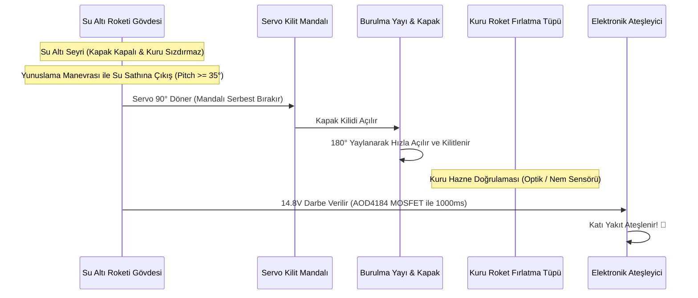

# 🚀 Kuru Faydalı Yük Bölmesi, Kapak ve Roket Ateşleme Mekanizması

Bu doküman, TEKNOFEST Görev 2 isterlerini karşılamak üzere geliştirilen su geçirmez roket podu, yay tahrikli mekanik kapak ve güvenli roket ateşleme mekanizmasının tasarım detaylarını açıklar.

---

## 1. Mekanik Mimari ve Çalışma Prensibi

---

## 2. Kuru Hazne Sızdırmazlık Tasarımı

* **Gövde Ayrımı:** Faydalı yük haznesi, aviyonik basınç gövdesinden bağımsız bir kompartıman olarak tasarlanır. Kapak açıldığında içeriye giren su damlacıkları kesinlikle aviyonik işlemci ve batarya bölmesine geçemez.
* **Kapak Contası:** Düz yüzey contasından ziyade, gövde oluğuna gömülen silikon sünger veya yumuşak EPDM profil (40-50 Shore A) tercih edilir.
* **Mandal Mekanizması:** Servo motor doğrudan kapağın hidrodinamik yükünü taşımaz; bir "Over-Center Latch" (ölü nokta kilidi) mekanizmasını tetikler. Böylece yüksek hızda su basıncı kapak mandalını zorlayamaz.

---

## 3. Safe-to-Arm Güvenlik Kilidi ve Ateşleme Devresi

Model roketin katı yakıt motorunun su altındayken yanlışlıkla ateşlenmesi büyük bir kural ihlali ve tehlikedir. Bu nedenle **3 Aşamalı Güvenlik Kilidi** uygulanır:

1. **Donanımsal Güvenlik Jumper'ı:** Karada hazırlık yapılırken devre açık devredir; araç suya bırakılmadan hemen önce takılır.
2. **Yazılımsal Yüzey Doğrulaması:**
   * Derinlik sensörü (`MS5837`) $z \le 0.05\text{ m}$ (araç su sathında) okumalıdır.
   * IMU (`BNO055`) burun açısı $30^\circ \le \theta \le 55^\circ$ aralığında olmalıdır.
   * Son 2 saniye boyunca derinlik değişimi sıfıra yakın olmalıdır (sabit yüzey trim dengesi).
3. **Opto-İzole Ateşleme Sürücüsü:**
   * 14.8V ana bataryadan beslenen N-Kanal Güç MOSFET'i (`AOD4184A`), optokuplör üzerinden STM32'nin `PC8` pininden gelen $1000\text{ ms}$ süreli aktif HIGH darbesiyle sürülür.
   * Gate ucunda $10\text{ k}\Omega$ pull-down direnci bulunarak mikrodenetleyici reset durumundayken ateşleyicinin yanlışlıkla tetiklenmesi donanımsal olarak engellenir.
