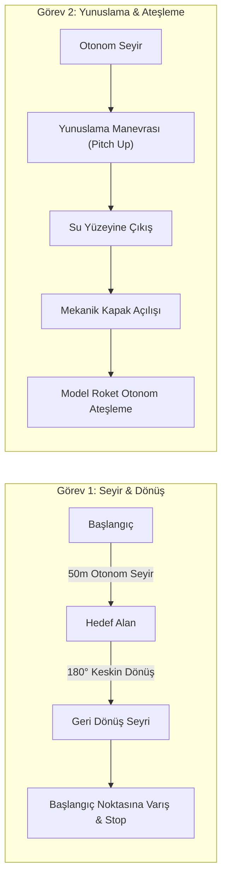
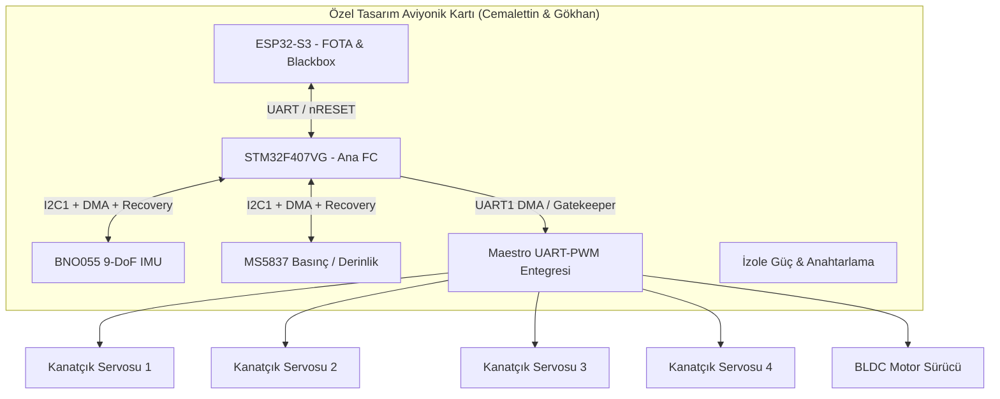
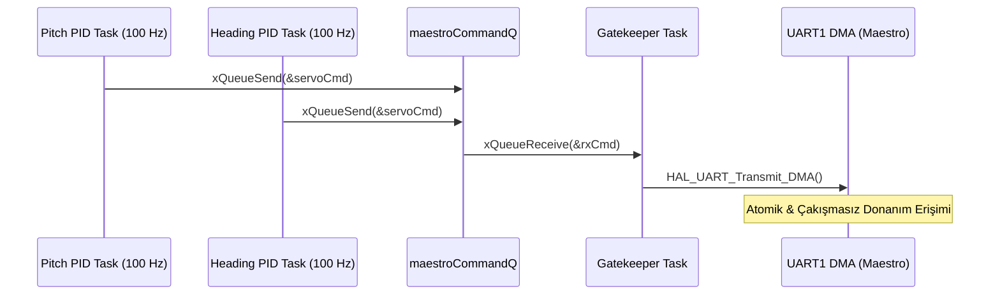
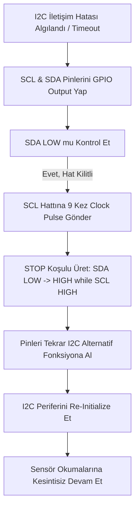

# Şampiyon Roketin Mühendislik Anatomisi: STM32, FreeRTOS ve FOTA ile Su Altı Otonomisi

> 📘 **Açık Kaynak Mühendislik Rehberi & Vaka Analizi:**  
> Bu doküman; Roketsan Su Altı Roketi Yarışması'nda Türkiye Birinciliği (Şampiyonluk) elde eden İTÜ Sungur Takımı'nın aviyonik, gömülü yazılım ve mekanik mimarisini, yarışmaya katılan **tüm takımlara rehberlik etmek ve açık kaynak bir referans oluşturmak** amacıyla sunmaktadır.

---

## İçindekiler
1. [Giriş ve Şampiyonluk Yolculuğu](#1-giriş-ve-şampiyonluk-yolculuğu)
2. [Yarışma Konsepti ve Mühendislik Gereksinimleri](#2-yarışma-konsepti-ve-mühendislik-gereksinimleri)
3. [Ana Kontrolcü ve Donanım Mimarisi: STM32F407 Seçim Sebepleri](#3-ana-kontrolcü-ve-donanım-mimarisi-stm32f407-seçim-sebepleri)
4. [Modern Gömülü Yazılım Geliştirme Ortamı ve Araç Yağmuru](#4-modern-gömülü-yazılım-geliştirme-ortamı-ve-araç-yağmuru)
5. [Kablosuz Güncelleme Mimarisi: ESP32-S3 ile FOTA ve Kara Kutu (Blackbox)](#5-kablosuz-güncelleme-mimarisi-esp32-s3-ile-fota-ve-kara-kutu-blackbox)
6. [FreeRTOS, DMA Mimarisi ve Konsept Tasarım Problemleri](#6-freertos-dma-mimarisi-ve-konsept-tasarım-problemleri)
7. [Otonom Görev Yönetimi: State Machine ve Event-Driven Tasarım](#7-otonom-görev-yönetimi-state-machine-ve-event-driven-tasarım)
8. [Sürücü Seviyesi Çözümler, C++ Template Mimarisi ve Sahadaki Krizler](#8-sürücü-seviyesi-çözümler-c-template-mimarisi-ve-sahadaki-krizler)
9. [Kazanılan Mühendislik Deneyimleri ve "Yeniden Yapsaydık" Öz-Eleştirisi](#9-kazanılan-mühendislik-deneyimleri-ve-yeniden-yapsaydık-öz-eleştirisi)

---

## 1. Giriş ve Şampiyonluk Yolculuğu

İTÜ Sungur Takımı olarak, **Roketsan** tarafından Mavi Vatan tersanelerinde düzenlenen Su Altı Roketi Yarışması’nda ilk yılımızda elde ettiğimiz üçüncülük derecesinin ardından, bu yıl tüm görevleri eksiksiz tamamlayarak **Türkiye birinciliği kupasına (Şampiyonluk)** uzandık. Bu başarı, tesadüfi bir lansman değil; aviyonik (gömülü yazılım ve elektronik), mekanik (yapısal, aerodinamik, sızdırmazlık) ve sponsorluk disiplinlerinden oluşan 26 kişilik tutkulu bir ekibin, disiplinler arası mühendislik metodolojisinin ürünüdür.

Gömülü sistemler mimarisi, navigasyon kestirimleri (ESKF) ve otonom kontrol döngülerinden sorumlu aviyonik ekibimizle, sadece şartnamedeki minimum isterleri karşılayan bir araç değil; sahada her türlü donanımsal ve çevresel krizde deterministik davranan modern bir otonom su altı roketi geliştirdik.

### Açık Kaynak Felsefesi ve Mühendislik Vizyonu

> *"Geçen sene yarışmanın ilk senesiydi ve bu konseptte açık kaynaklı hiçbir doküman, referans mimari veya hazır altyapı bulunmuyordu. İlk yıl derece alan tek takım olarak yakaladığımız momentumu; bu yıl elektronik, mekanik ve yazılım hatlarında sıfırdan mimariler inşa edip üstüne koyarak ilerletmek temel felsefemiz oldu."*

Bu doküman, su altı otonomisi ve roket ateşleme mekaniği üzerine çalışan tüm araştırmacılara ve mühendislik takımlarına referans bir mimari sunmayı amaçlamaktadır.

---

## 2. Yarışma Konsepti ve Mühendislik Gereksinimleri

Yarışma, geleneksel dinamik dinamikliğe sahip ROV (Remotely Operated Vehicle) sistemlerinden köklü biçimde ayrılan ve daha çok **Roketsan'ın kapsül atım sistemlerini** andıran zorlu aviyonik ve aerodinamik kısıtlara sahiptir:

* **Görev 1 (Seyir ve Geri Dönüş):** Başlangıç noktasından itibaren 50 metre boyunca su altından otonom seyir icra etme, 180 derecelik keskin dönüş manevrası yapma ve başlangıç noktasına tam otonom geri dönme.
* **Görev 2 (Yunuslama ve Model Roket Ateşleme):** Su altından hedeflenen güvenli bölgeye kadar otonom seyir, yüzeye yaklaşırken yönelim açısını değiştirerek "yunuslama" (*pitching*) hareketi ile su yüzeyine çıkış, gövde üzerindeki mekanik kapağı açma ve taşıdığı faydalı yük olan model roketi otonom olarak ateşleme.
* **Tasarım Kısıtları:**
  * Aracın hidrodinamik açıdan kesinlikle **torpido formunda (*torpedo shape*)** tasarlanması zorunludur.
  * Yönelim kontrolü yan iticilerle (*thruster*) değil, gövde üzerindeki **4 adet kontrol kanatçığıyla (+ veya X konfigürasyonunda)** sağlanmalıdır.
  * İtki sistemi ise yalnızca tek bir yöne kuvvet üreten **tek bir ana fırçasız motorla** sınırlandırılmıştır; motorla aracı su içinde asılı tutmak (*hovering*) veya motor açısını değiştirerek yönlendirmek kesinlikle yasaktır.



---

## 3. Ana Kontrolcü ve Donanım Mimarisi: STM32F407 Seçim Sebepleri

Ana uçuş kontrol kartında (FC) işlemci olarak **STM32F407VG (ARM Cortex-M4F)** mikrodenetleyicisi tercih edilmiştir. Bu kararın arkasında yatan mimari gerekçeler şunlardır:

1. **Donanımsal FPU ve CMSIS-DSP Desteği:** Seyir kestirimi (EKF/ESKF) ve kontrol matrislerindeki yoğun floating-point çarpımları ile matris ters alma işlemleri için donanımsal Floating Point Unit (FPU) kritik öneme sahiptir. ARM'ın sağladığı CMSIS-DSP statik kütüphaneleri, matris işlemlerini donanım seviyesinde optimize etmektedir.
2. **Perifer Zenginliği ve DMA Kanal Yeterliliği:** Sistemde 9'dan fazla sensör ve eyleyicinin aynı anda, CPU çekirdeğini bloklamadan okunması gerekmektedir. Piyasada bulunan birçok hazır ticari uçuş kartı veya alt seviye mikrodenetleyici, yetersiz donanımsal UART/I2C/SPI hatları nedeniyle ilk aşamada elenmiştir.
3. **Fiyat/Performans ve Tedarik Kolaylığı:** Türkiye şartlarında yedek kart tedariğinin hızlı yapılabilmesi, bütçe optimumluğu ve ARM mimarisinin FreeRTOS ile sunduğu yüksek deterministik uyum.

### Kontrolcü Mimarileri Karşılaştırma Tablosu

| Kriter | STM32F407VG | ESP32-S3 | Raspberry Pi |
| :--- | :--- | :--- | :--- |
| **İşlem Gücü ve Frekans** | 168 MHz (ARM Cortex-M4F, Donanımsal FPU) | 240 MHz Dual-Core Tensilica Xtensa LX7 | 1.5+ GHz Quad-Core Broadcom BCM2711 |
| **Avantajlar** | Donanımsal FPU, zengin DMA/Perifer mimarisi, yüksek determinizm, CMSIS-DSP entegrasyonu, düşük güç tüketimi. | Dahili Wi-Fi/Bluetooth, yüksek RAM (16MB Flash / 8MB PSRAM), yüksek frekans, dahili web server yeteneği. | Çok yüksek işlem gücü, Linux ekosistemi, ROS entegrasyonu, zengin görüntü işleme desteği. |
| **Dezavantajlar / Kullanım Amacı** | Kablosuz bağlantı eksikliği.<br>**Kullanım Amacı:** Ana Uçuş Kontrol Kartı (FC). | Zayıf FPU performansı, RTOS kesme gecikmeleri (*timing jitter*).<br>**Kullanım Amacı:** FOTA, Wi-Fi Server, Kara Kutu (Blackbox). | Non-realtime OS (Linux) nedeniyle yüksek zamanlama belirsizliği, yüksek güç tüketimi, yavaş açılış süresi.<br>**Kullanım Amacı:** Elendi (Gereksiz hantal). |

### Tek Parça Uçuş Kontrol Kartı (FC) Donanım Bileşenleri

Takım üyelerimiz **Cemalettin ve Gökhan** tarafından özel olarak tasarlanan tek parça uçuş kontrol kartı üzerinde şu donanım mimarisi yer almaktadır:

* **STM32F407VG:** Ana aviyonik ve otonom kontrol işlemcisi.
* **BNO055 IMU:** 9-serbestlik dereceli (DoF) mutlak yönelim, açısal hız ve ivme sensörü.
* **MS5837:** Yüksek hassasiyetli derinlik ve hidrostatik basınç sensörü.
* **ESP32-S3 Mimarisi:** FOTA kablosuz yazılım yükleme, Wi-Fi web sunucusu ve telemetri loglama birimi.
* **Servo ve Motor Güç Anahtarlama Hatları:** Kanatçık servoları ve fırçasız motor sürücüsü (ESC) için izole tetikleme ve güç hatları.
* **SWD ve USB DFU Pinleri:** Saha ortamında doğrudan SWD/GDB debug yapma ve acil durumlarda hızlı DFU kod yükleme konfigürasyonu.
* **Donanımsal Yedekli Portlar:** Sahada bozulabilecek sensörlerin hızlıca ikame edilebilmesi veya yeni sensör entegrasyonu için kart üzerine bilinçli olarak açıkta bırakılan ekstra donanımsal UART ve I2C pin hatları.



---

## 4. Modern Gömülü Yazılım Geliştirme Ortamı ve Araç Yağmuru

Geliştirme sürecinde STM32CubeIDE'nin hantal yapısı, yavaş derleme süreleri ve Git takibindeki karmaşıklığı nedeniyle **VS Code + CMake + Ninja** derleme altyapısına geçilmiştir.

```text
.vscode/
├── settings.json            # ARM GCC derleyici yolları ve CMake ortam değişkenleri
├── launch.json              # Cortex-Debug, GDB ve ELF hedef konfigürasyonları
└── c_cpp_properties.json    # Clangd ve C/C++ Intellisense sembol tanımları
CMakeLists.txt               # Makro tabanlı modüler derleme mimarisi
compile_commands.json        # Clangd tarafından otomatik üretilen sembol haritası
third_party/                 # CMSIS-DSP, FreeRTOS ve Segger RTT/SystemView kütüphaneleri
```

### Adım Adım Derleme Ortamı Yapılandırması

#### 1. Sabit Derleyici Yolları
Docker konteynerlerinin getirdiği hantallıktan kaçınmak adına, tüm ekibin bilgisayarlarında varsayılan olan CubeIDE altındaki `arm-none-eabi-gcc` derleyici yolları `.vscode/settings.json` içerisine sabitlenmiştir:

```json
{
  "cmake.configureSettings": {
    "CMAKE_C_COMPILER": "C:/ST/STM32CubeIDE_1.13.0/STM32CubeIDE/plugins/com.st.stm32cube.ide.mcu.externaltools.gnu-tools-for-stm32.../arm-none-eabi-gcc.exe",
    "CMAKE_CXX_COMPILER": "C:/ST/STM32CubeIDE_1.13.0/STM32CubeIDE/plugins/com.st.stm32cube.ide.mcu.externaltools.gnu-tools-for-stm32.../arm-none-eabi-g++.exe"
  }
}
```

#### 2. Ninja Build Entegrasyonu
GNU Make yerine Ninja derleme sistemi tercih edilerek incremental (artımlı) derleme süreleri 3 katına varan oranda hızlandırılmıştır.

#### 3. Makro Tabanlı Donanım Konfigürasyonu
Prototip aşamasındaki Pertinax delikli plakalar ile nihai PCB arasındaki pin ve donanım farkları `CMakeLists.txt` üzerinde tanımlanan derleme makroları ile yönetilmiştir:

```cmake
# CMake tabanlı donanım hedefi seçimi
option(TARGET_HARDWARE "Hedef donanim tipi" "PCB")

if(TARGET_HARDWARE STREQUAL "PCB")
    add_compile_definitions(HV_PCB)
elseif(TARGET_HARDWARE STREQUAL "PERTINAX")
    add_compile_definitions(HV_PERTINAX)
endif()
```

#### 4. Clangd Intellisense ve Sembol Haritası
Standart C/C++ Intellisense'in `#ifdef` ön işlemci makrolarındaki başarısızlığı **Clangd** eklentisi ile çözülmüştür. CMake'in ürettiği `compile_commands.json` sayesinde hatasız kod navigasyonu sağlanmıştır.

#### 5. Cortex-Debug ve Segger Profiling
`launch.json` üzerinden Cortex-Debug entegrasyonu yapılarak SVD (*System View Description*) dosyaları üzerinden donanım saklayıcıları (*registers*) anlık izlenmiştir. Ayrıca `third_party/` klasörüne dahil edilen **Segger SystemView** ve **RTT** araçları sayesinde FreeRTOS task geçişleri (*context switching*), kesme süreleri ve timing jitter değerleri mikrosaniye hassasiyetinde profillenebilmiştir.

---

## 5. Kablosuz Güncelleme Mimarisi: ESP32-S3 ile FOTA ve Kara Kutu (Blackbox)

Saha testlerinde gövde sızdırmazlık vidalarını açıp kablo ile STM32'ye bağlanmanın yarattığı 20-30 dakikalık zaman kayıplarını ve conta aşınmasını önlemek amacıyla **FOTA (Firmware Over-The-Air)** mimarisi kurulmuştur.

```text
+------------------+        Wi-Fi          +------------------+        UART        +------------------+
|  Mühendislik     | --------------------> |    ESP32-S3      | -----------------> |    STM32F407     |
|  Bilgisayarı     |   .bin / CRC32        | (Server/Blackbox)|   128-Byte Chunk   | (Custom Boot)    |
+------------------+                       +------------------+                    +------------------+
                                                    |
                                           8MB PSRAM Log Kaydı
                                        (Pitch, Heading, Depth)
```

### ST'nin Native Protocol (AN991) Kısıtı ve ESP32-S3 Tercihi

ST Microelectronics'in resmi **AN991** dokümanında tanımlanan standart USART bootloader protokolü; belirli pinlerin basılmasını, katı el sıkışma (*handshake*) dizilimlerini ve özel CRC şartlarını gerektirmektedir. Sahada bu protokolü işletmek oldukça riskli ve hantal kaldığı için özel bir Bootloader mimarisi geliştirilmiştir.

Donanım tarafında ESP32-S3 ile STM32F407 arasında yalnızca 3 hat (**nRESET**, **USART6 TX**, **RX**) kullanılmıştır. 240 MHz işlemcili, 16 MB Flash ve 8 MB PSRAM belleğe sahip ESP32-S3:
* Mühendislik bilgisayarı için bir **Wi-Fi Erişim Noktası (Access Point)** ve **Web Sunucusu** çalıştırır.
* Otonom sürüş esnasında IMU, basınç ve PID verilerini PSRAM üzerinde **Blackbox (Kara Kutu)** modunda saklar.
* Araç yüzeye çıktığında bu telemetri verileri kablosuz olarak çekilir.

### FOTA Veri Akış Adımları

1. Mühendislik bilgisayarından ESP32-S3 web sunucusuna derlenmiş yeni `.bin` dosyası yüklenir.
2. ESP32-S3 tarafında CRC32 algoritmasıyla yazılım paketinin bütünlüğü doğrulanır.
3. ESP32-S3, STM32F407'nin `nRESET` pinini LOW seviyesine çekerek mikrodenetleyiciyi donanımsal reset durumuna sokar.
4. STM32F407 açılışta `0x08000000` adresindeki **Custom Bootloader** yazılımını çalıştırır. ESP32-S3, 2 saniye içerisinde UART üzerinden `0x7F` senkronizasyon onay baytını gönderir.
5. Orijinal uygulama binary verisi, **128 baytlık parçalar (*chunks*)** halinde aktarılır. STM32 Bootloader her parçayı Flash belleğe yazıp ACK baytı döner.
6. Yükleme tamamlandığında Bootloader; kullanılan tüm çevre birimlerini (RCC, Timers, NVIC, USART) deaktive eder, Vektör Tablosu Offsetini (VTOR) kaydırır ve stack pointer'ı ayarlayarak `0x08010000` Application adresine zıplar (*jump*).

> [!WARNING]
> **Teknik Borç / Geliştirme Alanı (Güvenlik ve Bütünlük Uyarısı):**  
> Mevcut FOTA mimarisinde Wi-Fi sunucusu şifresiz çalıştığı için *Man-in-the-Middle* müdahalelerine açıktır. İkinci bir kritik teknik borç ise, ESP32-S3 ile STM32F407 arasındaki UART transferinde parça (*chunk*) bazlı ek bir CRC kontrolü bulunmamasıdır. Hat üzerinde oluşabilecek bir elektriksel gürültü durumunda STM32 hatalı veriyi Flash'a yazabilir.

---

## 6. FreeRTOS, DMA Mimarisi ve Konsept Tasarım Problemleri

Sistem geliştirmede Bare-Metal yapının getirdiği karmaşıklığı aşmak için FreeRTOS'a geçilmiştir. Ancak STM32 HAL kütüphanesinin bloklayan (*blocking*) mimarisi ile RTOS Scheduler'ı arasında ciddi çakışmalar yaşanmıştır.

### HAL & RTOS Uyumsuzluğu, NVIC Öncelikleri ve DMA Çözümü

Polling metoduyla çalışan bloklayan HAL fonksiyonları (örneğin bir sensör okumasındaki 6 saniyelik zaman aşımı beklemesi), FreeRTOS Scheduler'ını kilitlediği için sistemin `HardFault`'a düşmesine neden olmuştur. Bu problemi çözmek için tüm sensör ve aktüatör haberleşmeleri **DMA (Direct Memory Access)** mimarisine taşınmıştır.

Cortex-M4 NVIC kesme mimarisinde kritik bir kural uygulanmıştır:
* FreeRTOS API fonksiyonlarını (`xTaskNotifyFromISR` vb.) çağıran tüm DMA ve sensör kesmelerinin önceliği, kernel kesme sınırı olan `configMAX_SYSCALL_INTERRUPT_PRIORITY` (Sayısal olarak 6) seviyesinin altında (örneğin **7-15 arası önceliklerde**) tutulmuştur. Aksi takdirde kesmeler kernel context switch mekanizmasını bozarak sistemi çökertmektedir.
* STM32F407 üzerindeki sınırlı DMA Stream yetersizliğini aşmak için bazı haberleşme hatları Half-Duplex moda geçirilmiş, bazı hatların ise RX/TX DMA talepleri kapatılmıştır.

### Gatekeeper Task & Queue (Kuyruk) Mimarisi

Pitch PID ve Heading PID gibi birden fazla kontrol Task'ı, motor ve kanatçık açısını yöneten Maestro UART-to-PWM dönüştürücü entegresine (38400 baud rate) aynı anda UART üzerinden erişmeye çalıştığında veri hatları çakışmakta ve haberleşme kilitlenmekteydi. Bu atomik olmayan erişim sorunu bir **Gatekeeper Task ve Queue** mimarisi ile çözülmüştür:

```c
/* Gatekeeper Task ve Queue Mimarisi Yapılandırması */
typedef struct {
    uint8_t channel;
    uint16_t targetPosition;
} ServoCommand_t;

QueueHandle_t maestroCommandQ;

/* Kontrol Task'ı (Örn: Pitch PID) - Donanıma doğrudan ERİŞMEZ */
void vPitchControlTask(void *pvParameters) {
    ServoCommand_t cmd = {.channel = 0, .targetPosition = 1500};
    for(;;) {
        /* Veri atomik olarak kuyruğa aktarılır, UART hattı bloklanmaz */
        xQueueSend(maestroCommandQ, &cmd, portMAX_DELAY);
        vTaskDelay(pdMS_TO_TICKS(10)); // 100 Hz Kontrol Döngüsü
    }
}

/* Gatekeeper Task: Donanımsal UART Hattının Tek Sahibi */
void vGatekeeperTask(void *pvParameters) {
    ServoCommand_t rxCmd;
    for(;;) {
        /* Kuyrukta komut bekler (2ms time-out, 38400 baud hızıyla senkron) */
        if (xQueueReceive(maestroCommandQ, &rxCmd, pdMS_TO_TICKS(2)) == pdTRUE) {
            /* UART erişimi tek bir kanaldan, çakışmasız ve atomik icra edilir */
            HAL_UART_Transmit_DMA(&huart1, (uint8_t*)&rxCmd, sizeof(rxCmd));
        }
    }
}
```



---

## 7. Otonom Görev Yönetimi: State Machine ve Event-Driven Tasarım

Yarışma görevlerinin sahada dinamik olarak değiştirilebilmesi için Event-Driven bir komut mimarisi kurulmuştur.

* **Güvenli Bekleme ve Kalibrasyon:** Kod başladığında yarışma kuralı olan 90 saniyelik zorunlu bekleme süresi `vTaskDelay` ile yönetilir. Bu sırada IMU cayro stabilizasyonu ve derinlik sensörünün dikey sıfırlaması (*tare/offset*) tamamlanır.
* **Dinamik Komut İşleme (`commandQ`):** Kodun içine sabit parametreler gömmek (*hardcoding*) yerine, ESP32-S3 üzerinden Wi-Fi ile gelen `ARM`, `DISARM`, `SET_DEPTH`, `GO_DISTANCE` gibi komutlar `commandQ` üzerinden otonom görev motoruna aktarılır.
* **Modüler Görev Profilleri:** Görev tanımları modüler derleme makroları (`HV_ILK_GOREV`, `HV_IKINCI_GOREV`) halinde kurgulanmıştır.

```c
/* Otonom Görev Senaryosu Mantıksal Akışı */
void vMissionExecutionTask(void *pvParameters) {
    /* 1. Aşama: Sistem Arm Edilir ve Target Derinlik Set Edilir */
    sendMissionCommand(CMD_ARM, 0);
    sendMissionCommand(CMD_SET_DEPTH, 1.5); // 1.5 Metre Derinlik
    
    /* 2. Aşama: Otonom İlerleme ve Yönelim Manevrası */
    sendMissionCommand(CMD_GO_DISTANCE, 50); // 50 Metre Düz Seyir
    sendMissionCommand(CMD_TURN_HEADING, 180); // 180 Derece Dönüş
    
    /* 3. Aşama: Başlangıca Dönüş, Yunuslama ve Disarm */
    sendMissionCommand(CMD_GO_DISTANCE, 50);
    sendMissionCommand(CMD_DISARM, 0);
}
```

---

## 8. Sürücü Seviyesi Çözümler, C++ Template Mimarisi ve Sahadaki Krizler

### OS-Agnostic Sensör Sürücüleri

MS5837 ve BNO055 sensör sürücüleri yazılırken, kodun hem RTOS altında hem de RTOS scheduler'ı başlatılmadan önce (bare-metal startup aşamasında) sorunsuz çalışabilmesi için **Function Pointer Callback** mekanizması kurgulanmıştır. Pre-kernel aşamasında `xTaskGetSchedulerState()` kontrol edilerek sistemin hangi modda olduğu doğrulanır:

```c
/* OS-Agnostic Sürücü İçin Gecikme Soyutlama Katmanı */
typedef void (*DelayCallback_t)(uint32_t ms);

typedef struct {
    DelayCallback_t delay_ms;
} BNO055_Driver_t;

void myOSDelayFunction(uint32_t ms) {
    /* Kernel başlatılmışsa RTOS delay, başlatılmamışsa HAL_Delay çağrılır */
    if (xTaskGetSchedulerState() != taskSCHEDULER_NOT_STARTED) {
        vTaskDelay(pdMS_TO_TICKS(ms));
    } else {
        HAL_Delay(ms);
    }
}
```

### Sahada Kriz Yönetimi: I2C Bus Lock Recovery

Saha testlerimizde hem **İTÜ Olimpik Havuzu** tatlı su denemelerinde hem de **İTÜ Tuzla Kampüsü Deniz Testleri** ortamında tuzlu suyun ve elektriksel gürültünün etkisiyle MS5837 derinlik sensörünün I2C hattını kilitlediği (SDA çizgisinin slave donanım tarafından LOW'da tutulduğu) gözlemlenmiştir.

Aracın dibe vurmasını engelleyen **Bus Lock Recovery** algoritması geliştirilmiştir:
1. I2C hattı kilitlendiği anda STM32 tarafında SCL ve SDA pinleri anlık olarak GPIO Output moda çekilir.
2. SCL hattına donanımsal olarak **9 clock darbesi** vurularak slave entegrenin SDA hattını serbest bırakması (*I2C Bus Clear*) sağlanır.
3. Ardından I2C periferi re-init edilir.



### C++ Template Tabanlı Kalman Filtresi (ESKF)

Error State Kalman Filter (ESKF) matris hesaplamalarında, matris boyutları derleme zamanında belirlenen (`template <size_t Rows, size_t Cols>`) C++ yapıları kullanılmıştır.

Bu yaklaşım:
* Dinamik bellek ayırmayı (*zero-allocation*) tamamen engellemiş,
* Heap fragmentation riskini sıfırlamış,
* CMSIS-DSP statik kütüphaneleriyle birleştirilerek mikrosaniyeler mertebesinde yüksek hızlı matris çarpım performansı sunmuştur.

---

## 9. Kazanılan Mühendislik Deneyimleri ve "Yeniden Yapsaydık" Öz-Eleştirisi

İTÜ Sungur Takımı aviyonik ekibi olarak, şampiyonlukla taçlandırdığımız bu süreçte elde ettiğimiz tecrübeler ışığında mimari öz-eleştirilerimizi ve mühendislik karnemizi sunuyoruz:

### Mühendislik Karnesi (Do's & Don'ts)

| Yapılması Gerekenler (Do's) | Kaçınılması Gerekenler (Don'ts) |
| :--- | :--- |
| **Sensör Birleştirme:** Tüm sensör okumalarını tek bir Task altında toplayıp veri dağıtımını Getter/Setter mimarisi ile yapmak. | **Aşırı Task Kullanımı (Over-tasking):** Her sensör ve işlev için ayrı Task açarak işlemciyi Context Switch yüküne boğmak. |
| **Thread-Safe İletişim:** Task'lar arası veri transferlerinde tamamen Queue, Mutex veya Semaphore yapılarını kullanmak. | **Kritik Bölge Suistimali:** Değişken paylaşımlarında `portENTER_CRITICAL()` kullanarak kesmeleri (ISR) kapatmak ve determinizmi bozmak. |
| **Teşhis ve Güvenlik:** Tüm Task'ları 100 ms yenileme penceresine sahip bir Software Watchdog ve detaylı HardFault Handler ile izlemek. | **Teşhis Eksikliği:** HardFault Handler'ları boş bırakmak ve donanımsal kilitlenmeleri izleyecek Watchdog yapılarını ihmal etmek. |
| **Modern C++ Standartları:** Bütün katmanları baştan C++ Nesne Yönelimli (OOP) ve şablon (Template) mimarisiyle tasarlamak. | **Sabit dt Varsayımı:** Kontrol döngülerinde `vTaskDelay` sürelerinin mükemmel sabitliğine güvenmek (Donanımsal Timer ile dt ölçülmelidir). |

### Detaylı Mimari Öz-Eleştiri

1. **Over-Tasking Problemi:** Projede her sensör için ayrı bir RTOS task'ı açılması gereksiz Context Switch maliyetine yol açmıştır. İdeal mimari, sensör okumalarını tek bir IO task'ı altında toplayıp verileri getter/setter kalıbıyla sunmaktır.
2. **Kritik Bölge Suistimali:** Kod genelinde 20'den fazla noktada `portENTER_CRITICAL()` ve `portEXIT_CRITICAL()` kullanılması, kesmeleri kapattığı için sistemin determinizmini olumsuz etkilemiştir. Bunun yerine Queue yapıları tercih edilmelidir.
3. **Software Watchdog İhtiyacı:** Sistemdeki aktif task'ların sağlık durumunu denetleyen, 100 ms yenileme penceresine (*notification window*) sahip bütünleşik bir Software Watchdog mekanizmasının eksikliği tespit edilmiştir.
4. **Tam C++ Dönüşümü:** C ve C++ karması bir kod tabanı yerine, tüm projenin baştan sona C++ OOP, RAII ve Template yapılarıyla kurgulanması sistem güvenilirliğini en üst seviyeye taşıyacaktır.

---

### Emeği Geçenler ve Teşekkür
* **Takım:** İTÜ Sungur Takımı (26 Kişilik Disiplinler Arası Ekip)
* **Özel Teşekkür:** Donanım tasarımını gerçekleştiren takım arkadaşlarımız **Cemalettin** ve **Gökhan** başta olmak üzere tüm aviyonik, mekanik ve sponsorluk ekiplerimize.
* **Yarışma:** Roketsan Su Altı Roketi Yarışması (Mavi Vatan Tersaneleri)
