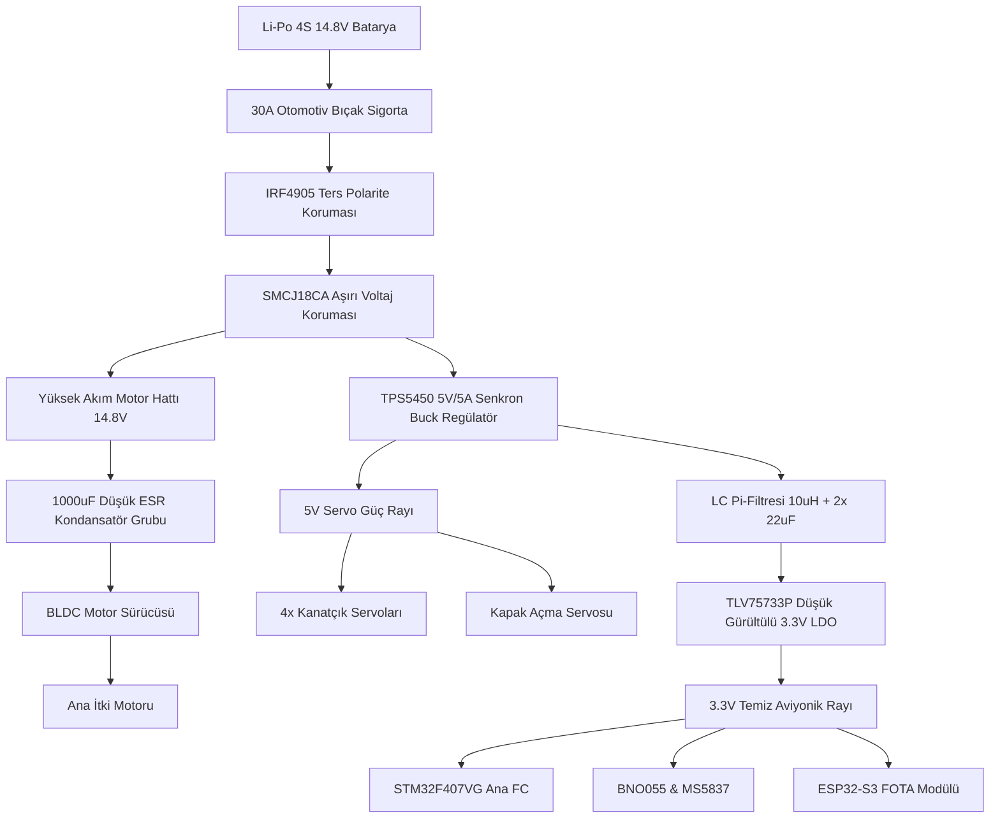

# ⚡ Güç Dağıtımı ve Galvanik İzolasyon Mimarisi

Su altı roketlerinde en sık karşılaşılan elektriksel arıza kaynağı; ana BLDC motorun ani kalkışlarında oluşan voltaj çökmeleri (*brownout*) ve ESC komütasyon anahtarlamasının I2C/UART sensör hatlarına indüklediği yüksek frekanslı elektromanyetik gürültüdür (EMI).

Bu rehber, aviyonik işlemci (STM32F407) ile yüksek akım çeken eyleyicilerin kararlı çalışmasını sağlayan devre topolojisini tanımlar.

---

## 1. Güç Katmanı Mimarisi ve Ayrımı



---

## 2. Kritik Koruma Devreleri

### A. Düşük Kayıplı Ters Polarite Koruması (P-MOSFET)
Geleneksel diyotlar (Schottky dahil) 20A akımda $V_f \approx 0.5\text{V}$ gerilim düşüşü yaratarak $10\text{W}$ civarında aşırı ısınmaya yol açar. Bunun yerine P-Kanal Güç MOSFET'i (`IRF4905` veya `IPB120P04P4`) kullanılır:
* **Gate Sürüşü:** Gate ucu $10\text{ k}\Omega$ direnç ile şaseye çekilir, $15\text{V}$ zener diyot ile gate-source aşırı gerilimden korunur.
* **Kayıp:** $R_{DS(on)} = 0.003\ \Omega$ $\rightarrow$ $20\text{A}$ akımda gerilim düşümü yalnızca $60\text{ mV}$, ısı kaybı ise sadece $1.2\text{ W}$ olur.

### B. ESC Endüktif Geri Tepme ve EMI Pi-Filtresi
Fırçasız motor komütasyonunda bobinlerin anahtarlanması $50 - 100\text{ kHz}$ frekansında sert voltaj iğneleri üretir:
* **Giriş Filtresi:** ESC güç girişine $1000\mu\text{F} / 35\text{V}$ Low-ESR elektrolitik kondansatör ve paralel $100\text{nF}$ seramik dekuplaj kondansatörü yerleştirilir.
* **LC Pi-Filtresi:** 5V Buck çıkışı ile 3.3V LDO girişi arasına $10\mu\text{H}$ güç bobini ve iki adet $22\mu\text{F}$ seramik kondansatör konarak mikrodenetleyicinin analog FPU ve ADC hatlarına gürültü geçişi engellenir.

---

## 3. Opto-İzole Sinyal Hatları

Kanatçık servoları ve ana motorun PWM tetik hatlarında oluşabilecek şase kaymalarını (*ground bounce*) önlemek için yüksek hızlı optokuplör (`6N137`, 10 MBd) kullanılır:

```text
STM32F407 GPIO (3.3V) -----[ 330 Ohm ]-----> [ 6N137 Anot (Pin 2) ]
                                            [ 6N137 Katot (Pin 3) ] -----> STM32 GND
                                            
                                            [ 6N137 VCC (Pin 8) ]   -----> Servo 5V
Servo Sinyal Girişi   <-------------------- [ 6N137 VOUT (Pin 6) ]
                                            (Pull-up 1k to Servo 5V)
                                            [ 6N137 GND (Pin 5) ]   -----> Servo GND
```

Bu yapı sayesinde motorun kilitlenmesi veya servoların suya temas etmesi durumunda oluşacak yüksek akım dalgalanması STM32 mikrodenetleyicisini yakamaz.
